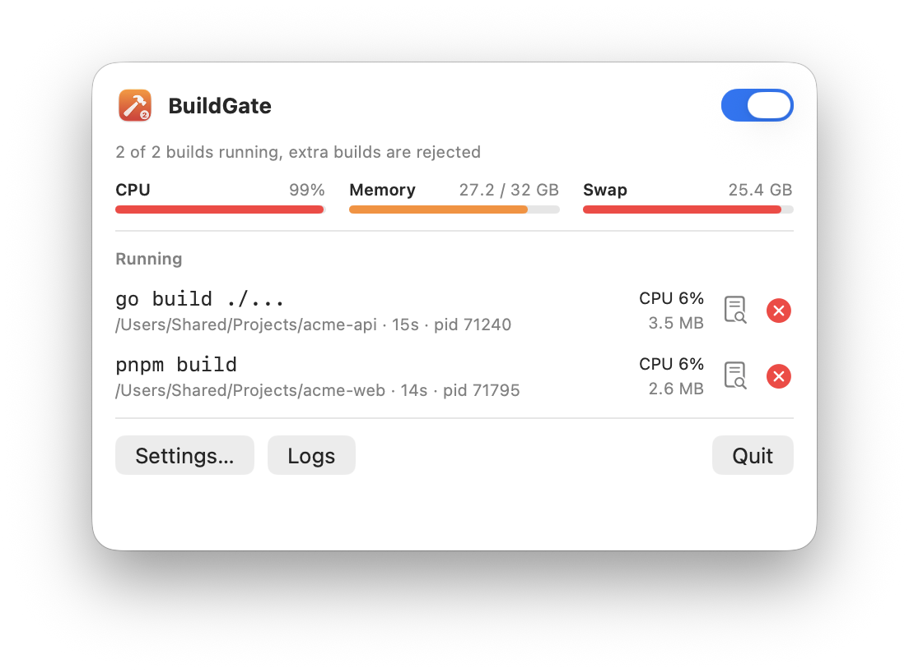
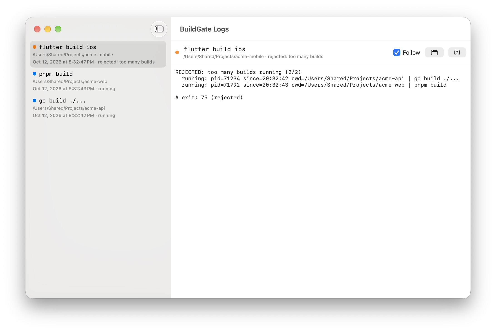
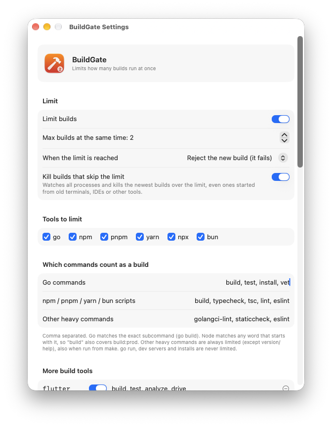

<p align="center">
  
</p>

<h1 align="center">BuildGate</h1>

<p align="center">
  A macOS menu bar app that lets only a few builds run at the same time,<br>
  so parallel AI agents, terminals and IDEs stop freezing your Mac.
</p>

<p align="center">
  
</p>

<p align="center">
  
</p>

## Why

Run three coding agents at once and each decides to `go build`, `pnpm build`
and `flutter build` at the same moment. The machine starts swapping, then
locks up. BuildGate puts a limit on how many builds run at once (2 by
default). A build over the limit is rejected straight away with a clear message,
or waits for a free slot if you prefer.

## Features

- **One limit for every build tool:** go, npm/pnpm/yarn/bun scripts, npx,
  tsc, vite, next, turbo, nx, flutter, dart, xcodebuild, swift, CocoaPods,
  gradle, react-native, expo, cargo, mvn, bazel, docker build,
  golangci-lint, eslint, and any tool you add.
- **Xcode app builds too:** ⌘B in Xcode takes a slot like any other build.
- **Reject or wait:** over the limit, a build fails fast with exit code 75
  and `TOO MANY BUILDS AT THE SAME TIME`, or waits in line.
- **Watchdog:** builds that skip the limit (old shells, IDEs, `./gradlew`) are
  noticed, and the newest ones over the limit are stopped.
- **Live view:** CPU, memory, swap, CPU temperature and network speed, plus each build's CPU and memory, with a
  ✕ to stop it and its live log.
- **Made for AI agents:** Claude Code and Codex get hooks that tell the agent
  *"BuildGate rejected this, it is not a compile error or out-of-memory: wait
  and retry"*, so they don't start "fixing" the wrong thing. Other agents get the
  same note in their global instructions.

<p align="center">
  
</p>

## Install

1. Download `BuildGate-x.y.z.dmg` from
   [Releases](../../releases/latest) and drag BuildGate to Applications.
2. The app is ad-hoc signed, not notarized. The first time, right-click it →
   **Open**, or run:
   ```sh
   xattr -dr com.apple.quarantine /Applications/BuildGate.app
   ```
3. Click the hammer in the menu bar → **Settings…** → **Shells and AI agents**
   → **Set up all**. Open a new terminal (or restart your agents).

That's it. Try it:

```sh
buildgate status                 # what holds the slots
buildgate sleep 60 & buildgate sleep 60 &
go build ./...                   # -> buildgate: REJECTED "go build ./..." - TOO MANY BUILDS AT THE SAME TIME (2/2 running)
```

<p align="center">
  
</p>

## How it works

```
 agent / terminal ──► go build ./...
                        │   (~/.buildgate/bin is first on PATH)
                        ▼
                ~/.buildgate/bin/go ──► buildgate gate
                        │   is this a build? (go build, pnpm build, flutter build, …)
                        │   take a slot: flock(~/.buildgate/locks/slot.N)
                        ├── got one ──► exec the real go, tee output to ~/.buildgate/logs
                        └── all busy ─► exit 75 "TOO MANY BUILDS" (or wait in line)
```

- **Shims:** `~/.buildgate/bin` holds `go`, `npm`, `pnpm`, `flutter`,
  `xcodebuild`, … symlinks to one small Go binary. Anything that isn't a build
  (`go run`, `npm install`, `flutter run`, `--version`) is passed straight to
  the real tool with `exec`, so it costs nothing.
- **Slots** are plain `flock(2)` locks, released by the kernel when a build
  exits or crashes, so they can never get stuck.
- **Builds inside builds count once:** a gated build sets `BUILDGATE_HELD=1`, so
  `flutter build ios → xcodebuild → swift` or `pnpm build → tsc` takes one slot.
- **Every shell:** `~/.buildgate/env.sh` is sourced from `~/.zshenv`,
  `~/.zprofile` and `~/.zshrc`, so login and non-login shells started by
  agents and IDEs see the shims first, even after `path_helper` and Homebrew
  reorder `PATH`.
- **The menu bar app** (SwiftUI) shows slots, builds and logs, edits
  `~/.buildgate/config.json`, runs the watchdog, and gives Xcode-app builds a slot.

## AI agents

| Agent | What BuildGate sets up |
|---|---|
| Claude Code | `PreToolUse`/`PostToolUse` hooks in `~/.claude/settings.json` (chains `rtk hook claude` if rtk is installed) |
| Codex | hooks in `~/.codex/hooks.json`, a note in `~/.codex/AGENTS.md`, `~/.buildgate` added as a sandbox writable root |
| Gemini CLI, opencode, Amp, Qwen Code, Copilot CLI, Factory Droid | a short note in the global instructions file |
| Anything else (Cursor, Zed, Aider, …) | covered by the shell setup |

`buildgate agents` shows what is set up; `buildgate setup all` does it from the
terminal. When a build is rejected or stopped, agents with hooks receive:

> BuildGate REJECTED `go build ./...` because 2 builds were already running
> (limit 2) … This was NOT a crash, compile error or out-of-memory … Wait for
> the running builds to finish, then rerun the same command.

## Configuration

Everything is in **Settings**, saved to `~/.buildgate/config.json`:

| Setting | Default |
|---|---|
| Max builds at the same time | 2 |
| When the limit is reached | reject (exit 75) · or wait in line |
| Kill builds that skip the limit | on |
| Go commands | `build test install vet` |
| npm / pnpm / yarn / bun scripts | `build typecheck tsc lint eslint` (prefix match, so `build:prod` too) |
| Other heavy commands | `golangci-lint staticcheck eslint` |
| More build tools | flutter, dart, xcodebuild, swift, pod, gradle, react-native, expo, tsc, vite, next, turbo, nx, cargo, mvn, bazel, docker. Edit, remove or add your own. |
| Xcode app builds | on |

## CLI

```
buildgate status          show running builds
buildgate <cmd> [args]    run any command under the limit (e.g. buildgate make release)
buildgate install         (re)create the shims
buildgate agents          shells and AI agents, and whether they are set up
buildgate setup [id|all]  set up shells and agents
```

## Build from source

Requires macOS 14+, Xcode command line tools and Go. Xcode 26 or newer adds
the Liquid Glass look on macOS 26+; older Xcode builds without it.

```sh
./build-dmg.sh                 # dist/BuildGate.app + dist/BuildGate-1.0.dmg (universal)
VER=1.2.0 ./build-dmg.sh       # set the version
./scripts/screenshots.sh       # regenerate docs/*.png with demo builds
```

## Releasing

Every push builds the DMG in GitHub Actions. Push a tag to publish a release
with the DMG and its SHA-256:

```sh
git tag v1.2.0 && git push origin v1.2.0
```

## Uninstall

1. Quit BuildGate and delete it from Applications.
2. Remove the `# buildgate` lines from `~/.zshenv`, `~/.zprofile` and
   `~/.zshrc`, and the BuildGate hooks from `~/.claude/settings.json` and
   `~/.codex/hooks.json`.
3. `rm -rf ~/.buildgate`

## License

[MIT](LICENSE)
